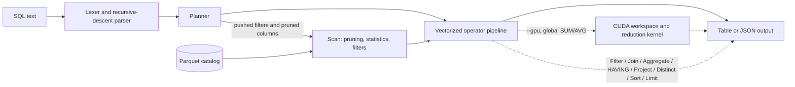

# qe — a columnar analytical query engine

[](https://github.com/abiralpokhrel-learns/query-engine/actions/workflows/ci.yml)
[](https://github.com/abiralpokhrel-learns/query-engine/actions/workflows/ci.yml)
[](https://github.com/abiralpokhrel-learns/query-engine/releases)
[](docs/engineering-writeup.md)
[](LICENSE)

<p align="center">
  
</p>

A small SQL query engine built from first principles in C++20. It reads Apache
Parquet, compiles a defined SQL subset into a vectorized operator pipeline, and
returns results that are tested against DuckDB. A Python harness benchmarks the
engine on the same data and queries as DuckDB, stores every timing, version, and
dataset detail needed to reproduce the numbers, and renders the published chart
from that stored data.

**Status: 0.2.0 with an optional CUDA global-aggregate path.** Version 1 is
complete, and selected version 2 features are now implemented: `DISTINCT`,
`HAVING`, `LEFT JOIN`, `IN` / `BETWEEN`, `OFFSET`, metadata-only `COUNT(*)`, a
top-k sort for `ORDER BY ... LIMIT`, and an opt-in CUDA build for global
aggregates. All 175 tests (166 CPU correctness tests plus 9 GPU-gated tests that
skip on CPU-only builds) pass against DuckDB on generated edge-case datasets,
the C++ parser suite passes, and the differential fuzzer matches DuckDB on
multi-seed sweeps. Every benchmark query is verified against DuckDB on the
1M-row dataset. The latest results are in
[`benchmarks/results/latest.md`](benchmarks/results/latest.md).

> **GPU note:** the default build is CPU-only. An optional CUDA build
> (`scripts/build.sh` with `QE_ENABLE_CUDA=ON`, or CMake
> `-DQE_ENABLE_CUDA=ON`) adds a narrow global-aggregate path for no-`GROUP BY`
> queries that combine `COUNT` with floating-point `SUM`/`AVG`; run it with
> `qe-cli --gpu`. The GPU computes the floating-point reductions; `COUNT` and
> the Parquet scan stay on the host. `--version` reports whether a usable CUDA
> device is available. Unsupported shapes, `GROUP BY`, integer/`MIN`/`MAX`
> aggregates, and queries with no rows after filtering fall back to the CPU path
> and report `gpu: used=0`. GPU timings are measured only when a kernel actually
> runs; no fabricated GPU numbers are reported. See the
> [engineering write-up](docs/engineering-writeup.md).

**Jump to:** [Demo](#demo) · [Quick start](#quick-start-from-a-clean-checkout) · [Architecture](#architecture) · [SQL subset](#sql-subset) · [Benchmarks](#benchmarks) · [Tests](#test-suite) · [Security](#security) · [Contributing](CONTRIBUTING.md)

## Highlights

- **Parquet-native storage.** Column pruning, predicate pushdown, row-group
  skipping, and metadata-only `COUNT(*)` are implemented in the scan, not
  simulated on top of a row store.
- **DuckDB-verified correctness.** End-to-end result tests, batch-size
  invariance, and a deterministic differential fuzzer compare every supported
  value against DuckDB before a feature is merged.
- **Performance claims with receipts.** Every benchmark query is verified before
  timing; raw runs, hardware, versions, and query text live in committed JSON,
  and the chart is regenerated from that file. Wins and losses are both reported.
- **CPU by default, CUDA opt-in.** The default build has no CUDA dependency. A
  separate CUDA build can move global floating-point reductions to the GPU and
  falls back explicitly for unsupported shapes.

## Demo

<p align="center">
  
</p>

<p align="center"><sub>Animated transcript rendered from actual <code>qe-cli</code> output on the 200k-row sample dataset; timings are machine-specific. <a href="docs/assets/demo-poster.png">Static preview</a>.</sub></p>

From WSL2 / Linux with the environment already built:

```bash
scripts/demo.sh
```

The demo registers the sample tables (generating them on first run if needed),
prints the engine version, then runs representative filter, aggregate, join,
top-k, `DISTINCT`, `LEFT JOIN`, and `HAVING` queries with timings and scan
statistics. It rebuilds the binary or regenerates the sample data if either
is missing. The terminal clip is generated by
[`scripts/render_demo_gif.py`](scripts/render_demo_gif.py) from a real CLI
session, not a hand-edited screenshot.

## Quick start from a clean checkout

```bash
# 1. Create the pinned C++ / Python environment (conda-forge).
micromamba env create -f environment.yml
micromamba activate qe

# 2. Build the engine.
scripts/build.sh

# 3. Run the test suites.
ctest --test-dir build --output-on-failure
python -m pytest tests -q

# 4. Run the demo.
scripts/demo.sh
```

`scripts/build.sh` honours `QE_PREFIX`, `CONDA_PREFIX`, `CMAKE_BIN`,
`BUILD_DIR`, `CMAKE_BUILD_TYPE`, `QE_WARNINGS_AS_ERRORS=ON`, and
`QE_ENABLE_CUDA=ON`. If no environment is active it falls back to `~/qe-env`,
the layout used during development.

### Optional CUDA build

The CUDA backend is opt-in and needs a CUDA toolkit with `nvcc` plus a visible
NVIDIA device. The default architecture is `86` (the RTX 3050 used for the
verified run); override it with `CMAKE_CUDA_ARCHITECTURES` for other hardware.

```bash
BUILD_DIR=build-cuda QE_ENABLE_CUDA=ON scripts/build.sh
build-cuda/qe-cli --version
QE_CLI=build-cuda/qe-cli python -m pytest tests -q
```

`--version` prints the device name, compute capability, memory, driver API
version, and `cuda_ops: global-aggregate`. The CUDA CTest self-test runs one
real reduction and returns skip code 77 when no device is present. The regular
CPU build remains the default and does not require a CUDA toolkit.

The CLI is self-documenting:

```text
$ build/qe-cli --help
qe-cli 0.2.0 - columnar SQL query engine

Usage:
  qe-cli [options] <file.parquet> [SQL]
  qe-cli [options] --table NAME=PATH [--table NAME=PATH ...] --query SQL

Options:
  --table NAME=PATH     Register a Parquet file under a SQL table name.
                        Repeat for joins. A positional .parquet path is
                        registered automatically under its file stem.
  --query SQL           SQL text. May also be the second positional argument.
  --format table|json   Output format (default: table).
  --max-rows N          Maximum result rows to display; -1 shows all.
                        Defaults to 50 for tables and all for JSON.
  --batch-size N        Vectorized batch size (default: 8192).
  --explain             Print the optimized plan and do not execute.
  --repeat N            Execute the query N times and report the last result.
  --gpu                 Use the optional CUDA global-aggregate path where
                        supported; the CPU path remains the default.
  --no-stats            Do not print scan statistics to stderr.
  -h, --help            Show this help.
  --version             Show the version.

Timings and scan statistics are written to stderr; query results go to stdout.
With `--gpu`, stderr also reports whether a GPU kernel ran, plus measured
transfer and kernel time.

Examples:
  qe-cli data/sales.parquet "SELECT region, SUM(amount) FROM sales GROUP BY region"
  qe-cli --table a=a.parquet --table b=b.parquet \
         --query "SELECT a.k, b.v FROM a JOIN b ON a.id = b.id LIMIT 10"
```

## What the engine does

### Architecture



The planner chooses the operator order for each query; the diagram shows the
default pipeline shape, not a fixed execution order. See the
[engineering write-up](docs/engineering-writeup.md) for the full design.

### Storage

- Reads flat Parquet files through Apache Arrow / Parquet C++.
- Projects only the columns a query references (column pruning).
- Skips row groups whose Parquet min/max statistics prove that a predicate
  cannot match.
- Applies residual filters while scanning, so rows are discarded before they
  reach the operators.
- Answers predicate-free `COUNT(*)` from row-group metadata without decoding a
  payload column.
- Emits fixed-size columnar `RecordBatch`es.

### SQL subset

```sql
SELECT [DISTINCT] [* | expr [AS alias], ...]
FROM table [alias]
[JOIN | LEFT [OUTER] JOIN table [alias] ON left.key = right.key ...]
[WHERE predicate]
[GROUP BY expr, ...]
[HAVING predicate]
[ORDER BY expr | ordinal [ASC|DESC], ...]
[LIMIT n] [OFFSET n];
```

Supported expressions: column references, integer / double / string / boolean
/ `NULL` literals, `+ - * /`, comparisons, `AND`, `OR`, `NOT`, `IS NULL`,
`IS NOT NULL`, `[NOT] IN (...)`, `[NOT] BETWEEN ... AND ...`, and `COUNT(*)`,
`COUNT(col)`, `SUM`, `AVG`, `MIN`, `MAX`. Inner and left outer joins support one
or more equality conditions. Identifiers are case-insensitive, quoted
identifiers and `''`-escaped strings are accepted, and dates are compared as ISO
`YYYY-MM-DD` literals.

`DISTINCT` removes duplicate output rows; `HAVING` filters groups after
aggregation; `OFFSET` skips rows after ordering; `COUNT(*)` with no predicate is
answered from Parquet metadata instead of decoding a column. `ORDER BY ...
LIMIT` uses a bounded top-k sort rather than sorting every matching row.

Unsupported SQL is rejected with a clear error rather than being silently
misinterpreted. Still out of scope: `RIGHT`/`FULL`/`CROSS`/`NATURAL` joins,
`JOIN ... USING`, `LIKE`, `NULLS FIRST/LAST`, `UNION`/`EXCEPT`/`INTERSECT`,
subqueries, CTEs, window functions, `DISTINCT` inside aggregates, aggregate
arguments that are expressions, `GROUP BY` expressions, and non-aggregate
columns mixed with aggregates.

### Execution

Operators process batches of 8,192 rows by default (`--batch-size` changes it):

```
Scan -> Filter -> Join -> Aggregate -> HAVING -> Project -> Distinct -> Sort -> Limit
```

The exact order is chosen by the planner: sort runs before projection when an
`ORDER BY` key is not selected, and distinct runs before sort because ordering
applies to the deduplicated rows. Left joins materialize the preserved side and
extend unmatched rows with typed `NULL`s. Filters are pushed into the scan during
planning. The planner also prunes columns, resolves aliases and ordinals, selects
the smaller join input as the build side, and inserts projections only where the
output schema requires them. `--explain` prints the optimized plan, including
pushed predicates and the columns read from each file.

<details>
<summary>Example <code>--explain</code> output for the demo query</summary>

```text
Project [region, orders, revenue]
  Sort ["sum(sales.amount)" DESC]
    Aggregate group=[sales.region] aggregates=[count(*), sum(sales.amount)]
      Scan sales (sales) columns=[region, amount, sale_date] rows=200000 pushdown=[(sales.sale_date >= '2024-01-01'), (sales.sale_date < '2024-02-01')]
```

The scan reads only the three referenced columns, and the date predicates are
pushed into Parquet so row groups outside January 2024 can be skipped. No rows
are decoded in `--explain` mode.

</details>

## Test suite

The Python suite compares every result with DuckDB on the same generated
Parquet files, including:

- filters with `NULL`, boolean, string, and date semantics;
- `IN` / `NOT IN` / `BETWEEN` / `NOT BETWEEN`, including `NULL` lists;
- empty inputs, empty groups, `NULL` groups, and single-row groups;
- integer and floating-point arithmetic, division, and negation;
- multi-key hash joins, duplicate keys, and `NULL` join keys;
- left joins with unmatched rows, `NULL` filters, and chained joins;
- `DISTINCT`, `HAVING`, `OFFSET`, aliases, ordinals, and `LIMIT 0`;
- top-k ordering and aggregate-after-join plans;
- unsupported SQL and CLI usage errors;
- row-group skipping and column pruning asserted from `--explain` and scan stats;
- metadata-only `COUNT(*)` and the empty plan it produces;
- identical results across batch sizes 1, 7, 128, and 8,192;
- on CUDA builds, GPU `COUNT`/`SUM`/`AVG` results against DuckDB, tiny-batch
  input handling, and CPU fallback for unsupported aggregates and grouping.

The C++ suite covers lexing, parsing, precedence, new clauses, and rejection of
out-of-scope SQL. The CUDA build also registers a device self-test that executes
a real reduction. A deterministic differential fuzzer
([`scripts/fuzz_compare.py`](scripts/fuzz_compare.py)) generates queries inside
the supported subset, runs each against this engine and DuckDB, and compares
every value; a 30-query sample is part of every pytest run.

```bash
python -m pytest tests -q                     # 175 tests; 9 GPU tests skip without a device
ctest --test-dir build --output-on-failure    # parser/unit tests
ctest --test-dir build-cuda --output-on-failure  # parser + CUDA device self-test
python scripts/fuzz_compare.py --queries 1000 --seed 2026
```

CI enforces `clang-format` and `ruff` formatting, builds with
`-Wall -Wextra -Wpedantic -Werror`, runs a separate AddressSanitizer /
UndefinedBehaviorSanitizer job, and reports line and branch coverage. The
coverage job enforces a 60% line threshold, uploads the detailed report as an
artifact, and updates the repository-hosted coverage badge from `main`.

## Benchmarks

The harness verifies every query against DuckDB before timing it, then records
warm-ups, repeats, raw runs, medians, query text, hardware, library versions,
and the dataset manifest. Charts are rendered from the stored JSON, never from
hand-typed numbers. Pull requests run the same harness and fail if a gated query's
CPU/DuckDB ratio grows more than 3x beyond the committed baseline. The new
`global_aggregate` query is verified and reported, but it is not a gate because
DuckDB's thread scaling makes its scan-bound ratio unstable across CI runners.

```bash
python scripts/run_benchmarks.py --rows 1000000 --repeats 5 --warmups 2
# Optional CUDA measurements; requires a CUDA build and a visible device.
QE_CLI=build-cuda/qe-cli python scripts/run_benchmarks.py \
  --rows 1000000 --repeats 3 --warmups 1 --gpu
```

Latest run: 1,000,000 sales rows, 16 row groups, 22.5 MB Parquet, batch size
8,192, AMD Ryzen 7 170 (16 logical CPUs), 7.4 GiB RAM in WSL2, Ubuntu 24.04,
NVIDIA GeForce RTX 3050 Laptop GPU (4 GB, compute 8.6, CUDA 12.9.86). DuckDB
used its default 16 threads; the engine is single-threaded. The GPU run used
three timed repetitions after one warm-up; `--gpu` also runs a device self-test
before timing so CUDA module loading is not charged to the first query.

<p align="center">
  
</p>

<p align="center"><sub>Chart generated from <code>benchmarks/results/latest.json</code> with <code>scripts/plot_benchmarks.py</code>. GPU bars are end-to-end medians and appear only for queries that actually ran a verified CUDA reduction.</sub></p>

| Query | qe CPU (ms) | qe GPU (ms) | DuckDB (ms) | CPU / DuckDB | GPU / CPU | GPU path |
|---|---:|---:|---:|---:|---:|---|
| filter_aggregate | 5.04 | 5.23 | 15.98 | 0.32x | 1.04x | CUDA |
| global_aggregate | 56.85 | 66.36 | 28.39 | 2.00x | 1.17x | CUDA |
| empty_filter | 0.22 | - | 10.14 | 0.02x | - | CPU fallback |
| group_region | 172.14 | - | 34.95 | 4.93x | - | CPU fallback |
| group_customer | 555.51 | - | 81.84 | 6.79x | - | CPU fallback |
| topk | 93.55 | - | 42.11 | 2.22x | - | CPU fallback |
| join_country | 435.34 | - | 60.64 | 7.18x | - | CPU fallback |
| count_star | 0.01 | - | 8.40 | 0.00x | - | CPU fallback |

Wins and losses are both reported. The engine wins on selective scans because
Parquet row-group statistics let it skip data and because its scan pipeline has
little overhead; it also wins metadata-only `COUNT(*)` because it decodes no
payload column. It loses on large hash aggregations, hash joins, and top-k
queries: the aggregate and join loops are row-wise inside each batch, while
DuckDB uses vectorized, multi-threaded operators. See the
[engineering write-up](docs/engineering-writeup.md) for the analysis and for the
optimization that cut the low-cardinality `GROUP BY` from 5.1 s to around 0.25 s.

The GPU result is deliberately not presented as a win. On `filter_aggregate`,
the GPU kernel itself is small (0.106 ms kernel, 0.329 ms transfer), but
workspace setup and host buffering cost slightly more than the 5.04 ms CPU
query, so the GPU path is 1.04x slower end to end. On `global_aggregate`, moving
the floating-point `SUM`/`AVG` work to the GPU does not offset that overhead:
66.36 ms versus 56.85 ms on the CPU, a 1.17x GPU/CPU ratio. The GPU path is also
slower than DuckDB's vectorized, multi-threaded aggregate. Repeated local runs
of the full-table sum straddle 1.0x, so the honest conclusion is that the
current path is roughly tied at best; the scan and host buffering dominate.
These are measured end-to-end query times, not transfer-only or kernel-only
speedups; the raw per-run values and separate transfer/kernel timings are in
[`benchmarks/results/latest.json`](benchmarks/results/latest.json) and
[`benchmarks/results/latest.md`](benchmarks/results/latest.md). Grouped
aggregates, filters, joins, integer sums, and `MIN`/`MAX` stay on the CPU.

## Repository layout

```
.github/
  workflows/ci.yml            build, test, sanitizer, coverage, benchmark jobs
  ISSUE_TEMPLATE/             bug report and feature request forms
  pull_request_template.md
src/
  cli/                        table and JSON output
  engine/                     expressions, keys, operators, planner, executor
  gpu/                        optional CUDA runtime, reduction kernel, CPU stub
  sql/                        lexer, recursive-descent parser, AST
  storage/                    Parquet catalog, schema checks, pushdown
tests/
  sql_test.cpp                C++ parser/unit tests
  cuda_test.cpp               CUDA device probe and real reduction self-test
  test_engine.py              end-to-end correctness vs DuckDB, including GPU-gated tests
scripts/
  build.sh                    CMake + Ninja build
  generate_data.py            deterministic Parquet generator
  run_benchmarks.py           verified benchmark harness
  check_benchmark_regressions.py  PR ratio regression check
  plot_benchmarks.py          chart renderer (stored JSON only)
  fuzz_compare.py             differential SQL fuzzer against DuckDB
  write_coverage_badge.py     shields.io badge from the gcovr summary
  render_demo_gif.py          README terminal transcript from real CLI output
  demo.sh                     one-command demo
benchmarks/
  results/                    latest verified JSON/Markdown report
  charts/                     chart generated from the stored JSON
data/                         generated sample data (created by the demo)
docs/
  assets/                     generated demo GIF, static poster, asset notes
  engineering-writeup.md
.clang-format                 C++ formatting rules
.editorconfig                 cross-editor whitespace and indent defaults
pyproject.toml                Python formatting and lint rules
CODE_OF_CONDUCT.md            community expectations and reporting
SECURITY.md                   private vulnerability-reporting policy
CHANGELOG.md                  release history
CONTRIBUTING.md               development and pull-request guide
```

The sample Parquet files are deterministic but are not committed; `scripts/demo.sh`
creates them on first run with `scripts/generate_data.py`.

## Verified environment

| Component | Version |
|---|---|
| OS | WSL2 Ubuntu 24.04.4 LTS, kernel 6.18.33.2 |
| Compiler | g++ 13.3.0 |
| Build system | CMake 4.4.5, Ninja 1.13.2 |
| Arrow / Parquet | 13.0.0 |
| DuckDB | 2.0.0 |
| Python | 3.12.16 |
| PyArrow / NumPy | 13.0.0 / 1.26.4 |
| Formatting | clang-format 23.1.4, ruff 0.17.4 |
| Coverage | gcovr 8.8 |
| CUDA toolkit | 12.9.86 (optional `QE_ENABLE_CUDA` build) |
| GPU | NVIDIA GeForce RTX 3050 Laptop GPU, 4 GB, compute 8.6, driver 591.84 (WSL2) |

## Known limits (0.2.0)

- Read-only, single-process, single-threaded engine.
- Flat schemas only; nested Parquet types are rejected.
- Inner and left joins only, with equality keys that must have exactly the same
  Arrow type on both sides. No right, full, cross, semi, or anti joins.
- No `LIKE`, `NULLS FIRST/LAST`, set operations, subqueries, CTEs, or window
  functions.
- No `DISTINCT` inside aggregates; aggregate arguments must be plain columns;
  `GROUP BY` accepts plain columns only.
- Sort and aggregation are in-memory and assume current data sizes; no spilling.
- Aggregation and join probing still contain row-wise inner loops; they are not
  yet vectorized or parallel.
- GPU acceleration is optional and narrow: a CUDA build can run no-`GROUP BY`
  queries that combine `COUNT` with floating-point `SUM`/`AVG`; the GPU computes
  only the floating-point reductions, while `COUNT`, filtering, and the Parquet
  scan stay on the host. Grouped aggregates, integer sums, `MIN`/`MAX`, filters,
  and joins use the CPU path. The benchmark harness has an opt-in `--gpu` mode
  and publishes measured, verified GPU results alongside the CPU results.

Remaining version 2 work is listed in the
[write-up](docs/engineering-writeup.md#8-limits-and-version-2-ideas): vectorized hash
aggregation and join probing, multi-threading, broader CUDA coverage
(grouped aggregates, filters, joins) on the verified RTX 3050, the remaining join
types and SQL clauses, join-key type coercion, spilling, and nested-type
support. These are listed rather than half-implemented.

## Development

`main` is protected: changes land through pull requests with green CI, and
history is kept linear. The [contributor guide](CONTRIBUTING.md) covers local
setup, code style, sanitizer builds, visual assets, and the full checklist for
adding a SQL feature. Participation is covered by the
[code of conduct](CODE_OF_CONDUCT.md). Release notes are in
[CHANGELOG.md](CHANGELOG.md).

## Security

`qe` is a local, read-only engine: it reads caller-supplied Parquet files and
does not open network ports. Please report suspected memory-safety, parser, or
dependencies issues through GitHub's private advisory flow rather than a public
issue. See [SECURITY.md](SECURITY.md) for scope and reporting details.

## Author

Built by [Abiral Pokhrel](https://github.com/abiralpokhrel-learns).

## License

MIT. See [LICENSE](LICENSE).
