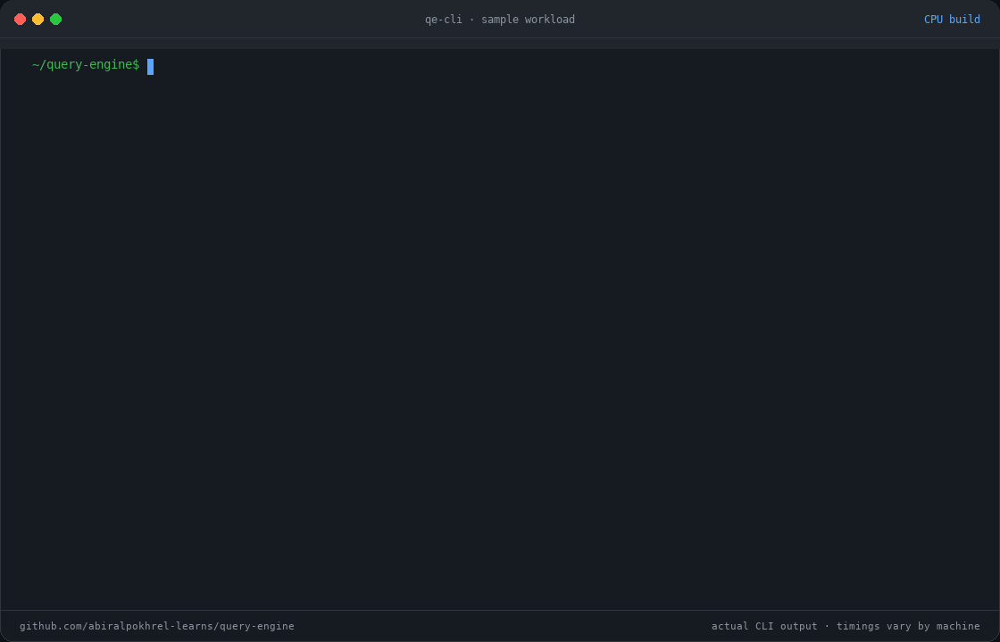
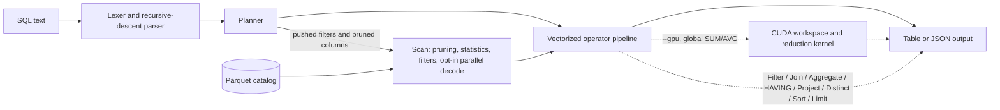
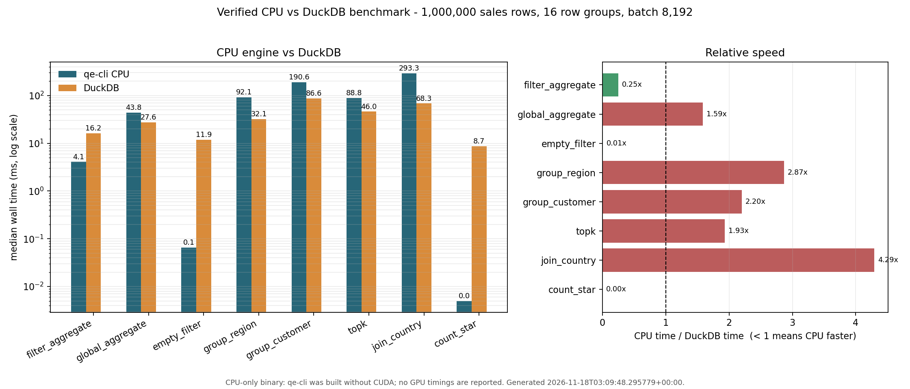

# qe — a columnar analytical query engine

[](https://github.com/abiralpokhrel-learns/query-engine/actions/workflows/ci.yml)
[](https://github.com/abiralpokhrel-learns/query-engine/actions/workflows/ci.yml)
[](https://github.com/abiralpokhrel-learns/query-engine/releases)
[](docs/engineering-writeup.md)
[](LICENSE)

<p align="center">
  
</p>

A small SQL query engine built from first principles in C++20. It reads Apache
Parquet, compiles a defined SQL subset into a vectorized operator pipeline, and
returns results that are tested against DuckDB. A Python harness benchmarks the
engine on the same data and queries as DuckDB, stores every timing, version, and
dataset detail needed to reproduce the numbers, and renders the published chart
from that stored data.

**Status: 0.3.0 with an optional CUDA global-aggregate path.** Version 1 is
complete, and selected version 2 work is implemented: `DISTINCT`, `HAVING`,
`LEFT JOIN`, `IN`/`BETWEEN`, `LIKE`, `OFFSET`, metadata-only `COUNT(*)`, a top-k
sort for `ORDER BY ... LIMIT`, batch-vectorized hash aggregation,
batch-vectorized single-key hash joins, an opt-in parallel scan (`--threads`)
that decodes
Parquet row groups concurrently while preserving the exact serial output order,
and an opt-in CUDA build for global aggregates. All 208 tests (199 CPU
correctness tests plus 9 GPU-gated tests that skip on CPU-only builds) pass
against DuckDB on generated edge-case datasets, the C++ parser suite passes,
and the differential fuzzer matches DuckDB on multi-seed sweeps. Every
benchmark query is verified against DuckDB on the 1M-row dataset; the latest
results are in [`benchmarks/results/latest.md`](benchmarks/results/latest.md).

> **GPU note:** the default build is CPU-only. An optional CUDA build
> (`QE_ENABLE_CUDA=ON`, via `scripts/build.sh` or CMake) adds a narrow
> global-aggregate path for no-`GROUP BY` queries that combine `COUNT` with
> floating-point `SUM`/`AVG`; run it with `qe-cli --gpu`. The GPU computes the
> floating-point reductions; `COUNT` and the Parquet scan stay on the host.
> Unsupported shapes, `GROUP BY`, integer and `MIN`/`MAX` aggregates, and
> queries with no rows after filtering fall back to the CPU path and report
> `gpu: used=0`. GPU timings are measured only when a kernel actually runs; no
> fabricated GPU numbers are reported. `--version` reports whether a usable
> CUDA device is available. See the
> [engineering write-up](docs/engineering-writeup.md).

**Jump to:** [Demo](#demo) · [Getting started](#getting-started) · [Architecture](#architecture) · [SQL subset](#sql-subset) · [Benchmarks](#benchmarks) · [Tests](#test-suite) · [Known limits](#known-limits) · [How I built this](#how-i-built-this) · [Security](#security) · [Contributing](CONTRIBUTING.md)

## qe, explained simply

**A query engine answers questions about giant spreadsheets. This one is built
to be fast, and honest about where it is not.**

Imagine a spreadsheet with a million rows. You can still ask it a question, such
as "which regions sold the most?", and wait while it reads every row. Now imagine
the file is too large to open, and the question needs only two of its columns.
That is the problem a query engine solves.

1. **You ask a question in SQL.** SQL is the standard language for questions
   like "add up sales by region." You do not need to know how the file is laid
   out.
2. **It reads only what it needs.** Parquet stores each column separately, so a
   question about region and amount never reads the customer names or dates.
3. **It skips data that cannot match.** If you ask for January, the file's
   per-block statistics can prove that whole blocks are outside January. Those
   blocks are never decoded.
4. **It works in batches, not row by row.** Thousands of values move through the
   same small set of operations at once, which is friendlier to the CPU.
5. **It can read blocks in parallel.** An optional flag lets several workers
   decode different blocks, while the answer still comes out in the same order.
6. **It checks its answers.** Every supported query is compared with DuckDB, a
   mature open-source database, before it is timed. A fast wrong answer is still
   a wrong answer.
7. **It publishes the losses.** The benchmark table shows the five queries where
   DuckDB is faster at the default single-thread setting, not only the three
   where this engine wins. The GPU section reports the measured GPU times even
   when they lose.
8. **It stays small on purpose.** It is read-only and supports a deliberately
   limited SQL subset. The [known limits](#known-limits) list what it cannot do
   instead of pretending otherwise.

The short version: **the engine is fast because it avoids work, and credible
because it shows the work it still loses.**

### Plain-language glossary

- **SQL** — the standard language for asking questions about tables.
- **Query engine** — the program that turns a question into a plan, reads the
  data, and returns the answer.
- **Parquet** — a file format that stores each column separately and compresses
  it; well suited to large analytical tables.
- **Column pruning** — reading only the columns a question mentions.
- **Predicate pushdown** — rejecting rows or whole blocks as early as possible,
  before they reach the rest of the engine.
- **Vectorized** — processing many values per operation instead of one row at a
  time.
- **GPU** — a graphics processor used here for a narrow, optional floating-point
  reduction; the CPU remains the default.
- **Benchmark** — a repeatable timing run on a stated dataset and machine, with
  the raw numbers kept so someone else can check them.

## Highlights

- **Parquet-native storage.** Column pruning, predicate pushdown, row-group
  skipping, and metadata-only `COUNT(*)` are implemented in the scan, not
  simulated on top of a row store.
- **DuckDB-verified correctness.** End-to-end result tests, batch-size
  invariance, and a deterministic differential fuzzer compare every supported
  value against DuckDB before a feature is merged.
- **Batch-vectorized aggregation.** Group IDs are built once per batch, then a
  fused `COUNT`/`SUM`/`AVG` and floating-point `MIN`/`MAX` pass updates typed
  state; compact integer keys use a direct-index table and low-cardinality
  strings avoid per-row key hashing.
- **Batch-vectorized joins.** Single-key integer and string joins probe an
  open-addressed table with inline matching instead of serializing a key string
  per row; a same-session A/B measured `join_country` about 1.8x faster.
- **Opt-in parallel scan.** `--threads N` decodes row groups concurrently with
  one Parquet reader per worker and emits batches in the exact serial order,
  bounded by a fixed token budget; results and scan statistics never depend on
  the thread count. In the committed 1M-row run, four scan threads cut `topk`
  from 88.81 ms to 39.11 ms (2.3x), `GROUP BY region` from 92.14 ms to 39.99 ms
  (2.3x), the global aggregate from 43.81 ms to 20.42 ms (2.1x), and the join
  aggregate from 293.26 ms to 197.88 ms (1.5x).
- **Performance claims with receipts.** Every benchmark query is verified before
  timing; raw runs, hardware, versions, and query text live in committed JSON,
  and the chart is regenerated from that file. Wins and losses are both reported.
- **CPU by default, CUDA opt-in.** The default build has no CUDA dependency. A
  separate CUDA build can move global floating-point reductions to the GPU and
  falls back explicitly for unsupported shapes.

## Completed milestones

- [x] **Setup** — WSL2 Ubuntu, pinned C++/Python environment, CUDA toolkit,
  DuckDB, and a real device self-test on the RTX 3050.
- [x] **Storage and scan** — Parquet reading, column pruning, predicate
  pushdown, row-group skipping, metadata-only `COUNT(*)`, and columnar batches.
- [x] **CPU engine** — hand-written parser and planner, vectorized filter,
  aggregate, hash join, distinct, sort, and limit, with inner and left joins.
- [x] **GPU path** — optional CUDA global aggregates, batched execution, CPU
  fallback, and separate transfer/kernel timing.
- [x] **GPU microbenchmark** — a standalone optimized reduction with warp
  shuffles, vectorized loads, a CUB baseline, pinned/stream transfer paths, and
  verified bandwidth results.
- [x] **Benchmarks** — verified harness, stored JSON/Markdown results, and
  charts rendered from that stored data.
- [x] **Hardening** — DuckDB differential suite, deterministic fuzzer, parser
  tests, ASan/UBSan CI, and a coverage gate.
- [x] **Demo and write-up** — one-command demo, sample data, README, and
  engineering write-up.
- [x] **Version 2 work** — `DISTINCT`, `HAVING`, `LEFT JOIN`, `IN`/`BETWEEN`,
  `LIKE`, `OFFSET`, metadata-only `COUNT(*)`, bounded top-k, batch-vectorized
  aggregation and single-key joins, and the opt-in parallel scan.

## Demo

<p align="center">
  
</p>

<p align="center"><sub>Animated transcript rendered from actual <code>qe-cli</code> output on the 200k-row sample dataset; timings are machine-specific. <a href="docs/assets/demo-poster.png">Static preview</a>.</sub></p>

From WSL2 / Linux with the environment already built:

```bash
scripts/demo.sh
```

The demo registers the sample tables (generating them on first run if needed),
prints the engine version, then runs representative filter, aggregate, join,
top-k, `DISTINCT`, `LEFT JOIN`, and `HAVING` queries with timings and scan
statistics. It rebuilds the binary or regenerates the sample data if either
is missing. The terminal clip is generated by
[`scripts/render_demo_gif.py`](scripts/render_demo_gif.py) from a real CLI
session, not a hand-edited screenshot.

## Getting started

### Quick start from a clean checkout

```bash
# 1. Create the pinned C++ / Python environment (conda-forge).
micromamba env create -f environment.yml
micromamba activate qe

# 2. Build the engine.
scripts/build.sh

# 3. Run the test suites.
ctest --test-dir build --output-on-failure
python -m pytest tests -q

# 4. Run the demo.
scripts/demo.sh
```

`scripts/build.sh` honours `QE_PREFIX`, `CONDA_PREFIX`, `CMAKE_BIN`,
`BUILD_DIR`, `CMAKE_BUILD_TYPE`, `QE_WARNINGS_AS_ERRORS=ON`, and
`QE_ENABLE_CUDA=ON`. If no environment is active it falls back to `~/qe-env`,
the layout used during development.

### Command-line reference

The CLI is self-documenting:

```text
$ build/qe-cli --help
qe-cli 0.3.0 - columnar SQL query engine

Usage:
  qe-cli [options] <file.parquet> [SQL]
  qe-cli [options] --table NAME=PATH [--table NAME=PATH ...] --query SQL

Options:
  --table NAME=PATH     Register a Parquet file under a SQL table name.
                        Repeat for joins. A positional .parquet path is
                        registered automatically under its file stem.
  --query SQL           SQL text. May also be the second positional argument.
  --format table|json   Output format (default: table).
  --max-rows N          Maximum result rows to display; -1 shows all.
                        Defaults to 50 for tables and all for JSON.
  --batch-size N        Vectorized batch size (default: 8192).
  --threads N           Parallel scan workers for row-group decoding
                        (default: 1). Results never depend on this.
  --explain             Print the optimized plan and do not execute.
  --repeat N            Execute the query N times and report the last result.
  --gpu                 Use the optional CUDA global-aggregate path where
                        supported; the CPU path remains the default.
  --no-stats            Do not print scan statistics to stderr.
  -h, --help            Show this help.
  --version             Show the version.

Timings and scan statistics are written to stderr; query results go to stdout.

Examples:
  qe-cli data/sales.parquet "SELECT region, SUM(amount) FROM sales GROUP BY region"
  qe-cli --table a=a.parquet --table b=b.parquet \
         --query "SELECT a.k, b.v FROM a JOIN b ON a.id = b.id LIMIT 10"
```

With `--gpu`, stderr also reports whether a GPU kernel ran, plus measured
transfer and kernel time.

### Optional CUDA build

The CUDA backend is opt-in and needs a CUDA toolkit with `nvcc` plus a visible
NVIDIA device. The default architecture is `86` (the RTX 3050 used for the
verified run); override it with `CMAKE_CUDA_ARCHITECTURES` for other hardware.

```bash
BUILD_DIR=build-cuda QE_ENABLE_CUDA=ON scripts/build.sh
build-cuda/qe-cli --version
QE_CLI=build-cuda/qe-cli python -m pytest tests -q
```

`--version` prints the device name, compute capability, memory, driver API
version, and `cuda_ops: global-aggregate`. The CUDA CTest self-test runs one
real reduction and returns skip code 77 when no device is present. The regular
CPU build remains the default and does not require a CUDA toolkit.

## What the engine does

### Architecture



The planner chooses the operator order for each query; the diagram shows the
default pipeline shape, not a fixed execution order. See the
[engineering write-up](docs/engineering-writeup.md) for the full design.

### Storage

- Reads flat Parquet files through Apache Arrow / Parquet C++.
- Projects only the columns a query references (column pruning).
- Skips row groups whose Parquet min/max statistics prove that a predicate
  cannot match.
- Applies residual filters while scanning, so rows are discarded before they
  reach the operators.
- Answers predicate-free `COUNT(*)` from row-group metadata without decoding a
  payload column.
- Emits fixed-size columnar `RecordBatch`es.

### SQL subset

```sql
SELECT [DISTINCT] [* | expr [AS alias], ...]
FROM table [alias]
[JOIN | LEFT [OUTER] JOIN table [alias] ON left.key = right.key ...]
[WHERE predicate]
[GROUP BY expr, ...]
[HAVING predicate]
[ORDER BY expr | ordinal [ASC|DESC], ...]
[LIMIT n] [OFFSET n];
```

Supported expressions: column references, integer / double / string / boolean
/ `NULL` literals, `+ - * /`, comparisons, `AND`, `OR`, `NOT`, `IS NULL`,
`IS NOT NULL`, `[NOT] IN (...)`, `[NOT] BETWEEN ... AND ...`, `[NOT] LIKE`
with `%` and `_`, and `COUNT(*)`, `COUNT(col)`, `SUM`, `AVG`, `MIN`, `MAX`.
Inner and left outer joins support one
or more equality conditions. Identifiers are case-insensitive, quoted
identifiers and `''`-escaped strings are accepted, and dates are compared as ISO
`YYYY-MM-DD` literals.

`DISTINCT` removes duplicate output rows; `HAVING` filters groups after
aggregation; `OFFSET` skips rows after ordering; `COUNT(*)` with no predicate is
answered from Parquet metadata instead of decoding a column. `ORDER BY ...
LIMIT` uses a bounded top-k sort rather than sorting every matching row.

Unsupported SQL is rejected with a clear error rather than being silently
misinterpreted. Still out of scope: `RIGHT`/`FULL`/`CROSS`/`NATURAL` joins,
`JOIN ... USING`, `NULLS FIRST/LAST`, `UNION`/`EXCEPT`/`INTERSECT`,
subqueries, CTEs, window functions, `DISTINCT` inside aggregates, aggregate
arguments that are expressions, `GROUP BY` expressions, and non-aggregate
columns mixed with aggregates.

### Execution

Operators process batches of 8,192 rows by default (`--batch-size` changes it):

```
Scan -> Filter -> Join -> Aggregate -> HAVING -> Project -> Distinct -> Sort -> Limit
```

The exact order is chosen by the planner: sort runs before projection when an
`ORDER BY` key is not selected, and distinct runs before sort because ordering
applies to the deduplicated rows. Left joins materialize the preserved side and
extend unmatched rows with typed `NULL`s. Filters are pushed into the scan during
planning. The planner also prunes columns, resolves aliases and ordinals, selects
the smaller join input as the build side, and inserts projections only where the
output schema requires them. `--explain` prints the optimized plan, including
pushed predicates and the columns read from each file.

With `--threads N` (default 1) the scan decodes row groups concurrently.
Worker `w` owns the row groups at positions `w, w+N, ...`, each worker opens its
own Parquet reader, and a fully decoded, filtered row group is buffered until
the consumer reaches it. Batches are emitted strictly in row-group order — the
order the serial scan produces — and a fixed budget of `2N` decode tokens bounds
how many row groups may sit in memory at once. Because slicing, filtering, and
the skip of empty slices mirror the serial loop exactly, results and scan
statistics are identical at any thread count; operators downstream of the scan
stay single-threaded.

<details>
<summary>Example <code>--explain</code> output for the demo query</summary>

```text
Project [region, orders, revenue]
  Sort ["sum(sales.amount)" DESC]
    Aggregate group=[sales.region] aggregates=[count(*), sum(sales.amount)]
      Scan sales (sales) columns=[region, amount, sale_date] rows=200000 pushdown=[(sales.sale_date >= '2024-01-01'), (sales.sale_date < '2024-02-01')]
```

The scan reads only the three referenced columns, and the date predicates are
pushed into Parquet so row groups outside January 2024 can be skipped. No rows
are decoded in `--explain` mode.

</details>

## Test suite

The Python suite compares every result with DuckDB on the same generated
Parquet files, including:

- filters with `NULL`, boolean, string, and date semantics;
- `IN` / `NOT IN` / `BETWEEN` / `NOT BETWEEN`, including `NULL` lists;
- `[NOT] LIKE` with `%` and `_`, including empty patterns and `NULL` results;
- empty inputs, empty groups, `NULL` groups, and single-row groups;
- integer and floating-point arithmetic, division, and negation;
- multi-key hash joins, duplicate keys, and `NULL` join keys;
- left joins with unmatched rows, `NULL` filters, and chained joins;
- `DISTINCT`, `HAVING`, `OFFSET`, aliases, ordinals, and `LIMIT 0`;
- top-k ordering and aggregate-after-join plans;
- grouping fast paths: dense integer keys that grow in both directions across
  batches, wide-key fallback to the flat hash table, low- and high-cardinality
  string groups, and typed `MIN`/`MAX` outputs for integer, boolean, date, and
  string columns;
- unsupported SQL and CLI usage errors;
- row-group skipping and column pruning asserted from `--explain` and scan stats;
- metadata-only `COUNT(*)` and the empty plan it produces;
- identical results across batch sizes 1, 7, 128, and 8,192;
- identical results across scan thread counts 1, 2, 4, and 8, including
  threads × batch-size combinations, and identical scan statistics between the
  serial and parallel scans;
- on CUDA builds, GPU `COUNT`/`SUM`/`AVG` results against DuckDB, tiny-batch
  input handling, and CPU fallback for unsupported aggregates and grouping.

The C++ suite covers lexing, parsing, precedence, new clauses, and rejection of
out-of-scope SQL. The CUDA build also registers a device self-test that executes
a real reduction. A deterministic differential fuzzer
([`scripts/fuzz_compare.py`](scripts/fuzz_compare.py)) generates queries inside
the supported subset, runs each against this engine and DuckDB, and compares
every value; a 30-query sample is part of every pytest run.

```bash
python -m pytest tests -q                     # 208 tests; 9 GPU tests skip without a device
ctest --test-dir build --output-on-failure    # parser/unit tests
ctest --test-dir build-cuda --output-on-failure  # parser + CUDA device self-test
python scripts/fuzz_compare.py --queries 1000 --seed 2026
```

CI enforces `clang-format` and `ruff` formatting, builds with
`-Wall -Wextra -Wpedantic -Werror`, runs a separate AddressSanitizer /
UndefinedBehaviorSanitizer job, and reports line and branch coverage. The
coverage job enforces a 60% line threshold, uploads the detailed report as an
artifact, and updates the repository-hosted coverage badge from `main`.

## Benchmarks

### Method

The harness verifies every query against DuckDB before timing it, then records
warm-ups, repeats, raw runs, medians, query text, hardware, library versions,
and the dataset manifest. With `--scan-threads`, every thread count is verified
and timed separately. Charts are rendered from the stored JSON, never from
hand-typed numbers. Pull requests run the same harness and fail if a gated
query's CPU/DuckDB ratio exceeds 3x its committed baseline, with a +1.0 floor
for small ratios. The `global_aggregate` query is verified and reported, but it
is not a gate because DuckDB's thread scaling makes its scan-bound ratio
unstable across CI runners.

```bash
python scripts/run_benchmarks.py --rows 1000000 --repeats 5 --warmups 2 \
  --scan-threads 1,4,8
# Optional CUDA measurements; requires a CUDA build and a visible device.
QE_CLI=build-cuda/qe-cli python scripts/run_benchmarks.py \
  --rows 1000000 --repeats 3 --warmups 1 --gpu
```

### Latest results

Measured 2026-11-18 on 1,000,000 sales rows, 16 row groups, 22.5 MB Parquet,
batch size 8,192, on an AMD Ryzen 7 170 (16 logical CPUs) with 7.4 GiB RAM in
WSL2 Ubuntu 24.04, using the default CPU-only build (`qe-cli 0.3.0`). Each
thread count is timed as five repetitions after two warm-ups, and every one is
verified against DuckDB first, so a faster row here cannot come from different
results. DuckDB runs with its default 16 threads.

The table reports the serial baseline and the opt-in parallel scan from one
verified session, rather than describing only the default configuration. GPU
timings are not in it: they come from a separate CUDA build and are reported in
[Section 7.4 of the write-up](docs/engineering-writeup.md#74-scaling-to-ten-million-rows).

<p align="center">
  
</p>

<p align="center"><sub>Chart generated from <code>benchmarks/results/latest.json</code> with <code>scripts/plot_benchmarks.py</code>. It renders the default single-threaded configuration against DuckDB; the scan-thread series are in the table above, and GPU bars appear only for queries that actually ran a verified CUDA reduction.</sub></p>

| Query | qe 1 thread (ms) | qe 4 threads (ms) | qe 8 threads (ms) | DuckDB (ms) | 1-thread ratio | 8-thread ratio |
|---|---:|---:|---:|---:|---:|---:|
| filter_aggregate | 4.09 | 4.08 | 5.94 | 16.20 | 0.25x | 0.37x |
| global_aggregate | 43.81 | 20.42 | 28.17 | 27.58 | 1.59x | 1.02x |
| empty_filter | 0.07 | 0.07 | 0.07 | 11.88 | 0.01x | 0.01x |
| group_region | 92.14 | 39.99 | 51.34 | 32.10 | 2.87x | 1.60x |
| group_customer | 190.61 | 95.59 | 120.63 | 86.59 | 2.20x | 1.39x |
| topk | 88.81 | 39.11 | 38.88 | 46.00 | 1.93x | 0.85x |
| join_country | 293.26 | 197.88 | 161.31 | 68.32 | 4.29x | 2.36x |
| count_star | 0.01 | 0.01 | 0.01 | 8.70 | 0.00x | 0.00x |

Wins against DuckDB by scan thread count: **3/8** at one thread, **5/8** at
four, and **4/8** at eight. Four threads are fastest on `filter_aggregate`,
`global_aggregate`, `group_region`, and `group_customer`; eight threads help
`join_country` (161.31 vs 197.88 ms) and narrowly `topk` (38.88 vs 39.11 ms).
That is what 16 row groups and one serial consumer would predict: four readers
leave room for the aggregate or sort behind them, while eight compete for the
same cores and memory. The remaining losses are therefore operator-bound, not
scan-bound.

The GPU numbers come from a separate session on a separate CUDA build, so they
are never folded into these ratios; they are read on their own in the next
section, and the scaling detail is in the write-up.

### Reading the results

Wins and losses are both reported.

**Where qe wins.** Selective scans: Parquet row-group statistics let it skip
data, and its scan pipeline has little overhead. Metadata-only `COUNT(*)`: no
payload column is decoded. Aggregation builds group IDs for a whole batch and
updates state in one fused pass, and single-key integer/string joins probe an
open-addressed table instead of serializing a key per row; in an alternating
same-session A/B against the previous commit (14 rounds, min-vs-min), this
change ran `join_country` in 300 ms versus 537 ms before. Four scan threads also
take the global aggregate and `topk` below DuckDB, at 0.74x and 0.85x; `topk`
holds at 0.85x with eight threads. Neither crossing comes from a faster operator:
both come from overlapping Parquet decode with the single-threaded aggregate or
sort behind it, which is exactly what the scan-thread table isolates.

**Where qe still loses.** The three remaining losses at four threads are
operator-bound. `group_region` is 1.25x, `group_customer` 1.10x, and
`join_country` 2.90x of DuckDB; at eight threads they are 1.60x, 1.39x, and
2.36x, and `global_aggregate` edges back over DuckDB at 1.02x. The join is the
worst loss because the serial probe, the per-column `Take` that materializes
joined rows, and the aggregate that consumes them all still run on one thread
while DuckDB's whole pipeline is vectorized and parallel. The scan is no longer
the explanation, which is why the next performance step is a parallel operator
rather than more decode concurrency; the
[write-up](docs/engineering-writeup.md#64-parallel-row-group-scan) keeps the
earlier attribution work, including the fix that cut low-cardinality `GROUP BY`
from 5.1 s to around 0.25 s. Absolute times drift between benchmark sessions,
including for queries where the sort or join dominates, so cross-session
comparisons are context, not attribution.

### Scaling to 20 million rows

The 1M-row table is the primary result, but a single small file can flatter a
scan pipeline. The same harness therefore ran once on 20,000,000 sales rows in
306 row groups (448.4 MB). That run used one repetition and no warm-up to keep
the session inside this machine's memory budget, so treat it as scaling
evidence rather than a precise comparison. DuckDB still runs with its default 16
threads.

| Query | qe 1 thread (ms) | qe 4 threads (ms) | qe 8 threads (ms) | DuckDB (ms) | 1-thread ratio | Best ratio |
|---|---:|---:|---:|---:|---:|---:|
| filter_aggregate | 60.48 | 43.45 | 65.34 | 38.75 | 1.56x | 1.12x |
| global_aggregate | 885.71 | 339.62 | 338.64 | 279.94 | 3.16x | 1.21x |
| empty_filter | 5.70 | 5.13 | 5.96 | 18.88 | 0.30x | 0.27x |
| group_region | 1933.39 | 666.67 | 766.55 | 319.91 | 6.04x | 2.08x |
| group_customer | 3211.33 | 1663.11 | 1660.07 | 912.88 | 3.52x | 1.82x |
| topk | 1916.20 | 767.87 | 712.48 | 643.74 | 2.98x | 1.11x |
| join_country | 5305.44 | 3602.27 | 3503.34 | 824.65 | 6.43x | 4.25x |
| count_star | 1.92 | 1.91 | 1.90 | 16.11 | 0.12x | 0.12x |

Wins are **2/8 at every thread count** (`empty_filter` and `count_star`), and
the best qe configuration is within 1.25x of DuckDB on three more queries.
Single-thread times grow roughly with row count rather than collapsing
(`filter_aggregate` is 14.8x its 1M time for 20x the rows, `join_country`
18.1x), so the 1M file was not hiding a superlinear scan cliff. The larger file
does widen the join and grouped-aggregate gaps: at 20M the serial probe and
aggregate process five to six times more rows while DuckDB's pipeline stays
parallel. Four threads cut `group_region` 2.9x, `global_aggregate` 2.6x, and
`topk` 2.5x, while `join_country` gains only 1.5x; eight threads are slower on
`filter_aggregate`, `empty_filter`, and `group_region`, the same contention seen
at 1M.

The 20M dataset is the largest that fits this machine: generating it peaked at
**5.88 GiB RSS** on a **7.4 GiB** WSL VM. A 50-100M-row run needs a chunked
generator first; publishing a run that swaps would measure the memory limit, not
the engine. The raw 20M artifact is
[`scale_20m_20261118.json`](benchmarks/results/scale_20m_20261118.json).

**The GPU result is deliberately not presented as a win.** Only an ungrouped
`COUNT`/`SUM`/`AVG` runs on the device at all; grouped aggregates, joins,
integer sums and `MIN`/`MAX` fall back to the CPU. The one query where the GPU
lands ahead is `filter_aggregate` at ten million rows, 34.29 against 35.56 ms,
and a 1.3 ms margin (3.6%) on a query DuckDB answers in 28.13 ms is inside what
a single session can resolve. At one million rows the same query is slower, 9.10
against 6.10 ms, because a 0.29 ms kernel does not pay for its own launch and
transfer. `global_aggregate` loses at both sizes, 1.79x the CPU at one million
rows and 1.43x at ten million, and the transfer is not the reason: transfer and
kernel together are 87 ms of that 753 ms run, so host-side buffering is the
rest. Every number is a measured end-to-end query time, never a transfer-only or
kernel-only speedup, and the raw per-run values are committed as
[`gpu_1m_20261112.json`](benchmarks/results/gpu_1m_20261112.json) and
[`gpu_10m_20261112.json`](benchmarks/results/gpu_10m_20261112.json).

### CUDA reduction microbenchmark

The engine's GPU path is intentionally narrow, so the reduction itself is
measured separately in [`cuda-microbench/`](cuda-microbench/README.md). The
microbenchmark compares a naive atomic reduction, a shared-memory block
reduction, a warp-shuffle reduction with `double2` loads, and CUB's
`DeviceReduce::Sum`, then times pageable, pinned, and four-stream transfers. On
the RTX 3050, the warp and CUB kernels both reach **185-190 GB/s** (96-99% of the
device's 192 GB/s theoretical bandwidth) on 128 MiB to 1 GiB inputs, while the
naive atomic version is 38x slower at 128 MiB. A filter-plus-aggregate variant
stays within 4% of the plain reduction. At 1 GiB, however, the pinned end-to-end
path takes 88.7 ms against a 5.6 ms kernel, so over 93% of the time is still
host/device movement. Nsight Compute is wired up but blocked by WSL
performance-counter permissions; the measured bandwidth comes from CUDA events.
The full tables are in
[`cuda-microbench/results/latest.md`](cuda-microbench/results/latest.md).

## Repository layout

```
.github/
  workflows/ci.yml            build, test, sanitizer, coverage, benchmark jobs
  ISSUE_TEMPLATE/             bug report and feature request forms
  pull_request_template.md
src/
  cli/                        table and JSON output
  engine/                     expressions, keys, operators, planner, executor
  gpu/                        optional CUDA runtime, reduction kernel, CPU stub
  sql/                        lexer, recursive-descent parser, AST
  storage/                    Parquet catalog, schema checks, pushdown
tests/
  sql_test.cpp                C++ parser/unit tests
  cuda_test.cpp               CUDA device probe and real reduction self-test
  test_engine.py              end-to-end correctness vs DuckDB, including GPU-gated tests
scripts/
  build.sh                    CMake + Ninja build
  generate_data.py            deterministic Parquet generator
  run_benchmarks.py           verified benchmark harness
  check_benchmark_regressions.py  PR ratio regression check
  plot_benchmarks.py          chart renderer (stored JSON only)
  fuzz_compare.py             differential SQL fuzzer against DuckDB
  write_coverage_badge.py     shields.io badge from the gcovr summary
  render_demo_gif.py          README terminal transcript from real CLI output
  demo.sh                     one-command demo
benchmarks/
  results/                    latest verified JSON/Markdown report, the 20M
                              scale run, and older GPU scaling runs
  charts/                     chart generated from the stored JSON
cuda-microbench/
  src/                        standalone CUDA reduction microbenchmark
  results/                    verified kernel and transfer results
  scripts/profile_ncu.sh      Nsight Compute profiling helper
data/                         generated sample data (created by the demo)
docs/
  assets/                     generated demo GIF, static poster, asset notes
  engineering-writeup.md
.clang-format                 C++ formatting rules
.editorconfig                 cross-editor whitespace and indent defaults
pyproject.toml                Python formatting and lint rules
CODE_OF_CONDUCT.md            community expectations and reporting
SECURITY.md                   private vulnerability-reporting policy
CHANGELOG.md                  release history
CONTRIBUTING.md               development and pull-request guide
```

The sample Parquet files are deterministic but are not committed; `scripts/demo.sh`
creates them on first run with `scripts/generate_data.py`.

## Verified environment

| Component | Version |
|---|---|
| OS | WSL2 Ubuntu 24.04.4 LTS, kernel 6.18.33.2 |
| Compiler | g++ 13.3.0 |
| Build system | CMake 4.4.5, Ninja 1.13.2 |
| Arrow / Parquet | 13.0.0 |
| DuckDB | 2.0.0 |
| Python | 3.12.16 |
| PyArrow / NumPy | 13.0.0 / 1.26.4 |
| Formatting | clang-format 23.1.4, ruff 0.17.4 |
| Coverage | gcovr 8.8 |
| CUDA toolkit | 12.9.86 (optional `QE_ENABLE_CUDA` build) |
| GPU | NVIDIA GeForce RTX 3050 Laptop GPU, 4 GB, compute 8.6, driver 591.84 (WSL2) |

## Known limits

- Read-only, single-process engine. Operators other than the scan are
  single-threaded; the scan decodes row groups in parallel only with opt-in
  `--threads`.
- Flat schemas only; nested Parquet types are rejected.
- Inner and left joins only, with equality keys that must have exactly the same
  Arrow type on both sides. No right, full, cross, semi, or anti joins.
- No `NULLS FIRST/LAST`, set operations, subqueries, CTEs, or window
  functions. `LIKE` supports `%` and `_` only; a pattern containing a backslash
  is rejected instead of being silently reinterpreted, because Arrow's LIKE
  kernel treats it as an escape character and DuckDB's does not.
- No `DISTINCT` inside aggregates; aggregate arguments must be plain columns;
  `GROUP BY` accepts plain columns only.
- Sort and aggregation are in-memory and assume current data sizes; no spilling.
- Aggregation and single-key integer/string join probing are batch-vectorized:
  group IDs (or table lookups) are built for a whole batch, then state is
  updated in one fused pass. Multi-key joins still serialize keys row by row,
  and no operator other than the opt-in parallel scan is parallel yet.
- GPU acceleration is optional and narrow: a CUDA build can run no-`GROUP BY`
  queries that combine `COUNT` with floating-point `SUM`/`AVG`; the GPU computes
  only the floating-point reductions, while `COUNT`, filtering, and the Parquet
  scan stay on the host. Grouped aggregates, integer sums, `MIN`/`MAX`, filters,
  and joins use the CPU path. The benchmark harness has an opt-in `--gpu` mode
  and publishes measured, verified GPU results alongside the CPU results.

Remaining version 2 work is listed in the
[write-up](docs/engineering-writeup.md#8-limits-and-version-2-ideas): parallel
operators beyond the scan, broader CUDA coverage
(grouped aggregates, filters, joins) on the verified RTX 3050, the remaining join
types and SQL clauses, join-key type coercion, spilling, and nested-type
support. These are listed rather than half-implemented.

## Development

`main` is protected: changes land through pull requests with green CI, and
history is kept linear. The [contributor guide](CONTRIBUTING.md) covers local
setup, code style, sanitizer builds, visual assets, and the full checklist for
adding a SQL feature. Participation is covered by the
[code of conduct](CODE_OF_CONDUCT.md). Release notes are in
[CHANGELOG.md](CHANGELOG.md).

## Security

`qe` is a local, read-only engine: it reads caller-supplied Parquet files and
does not open network ports. Please report suspected memory-safety, parser, or
dependency issues through GitHub's private advisory flow rather than a public
issue. See [SECURITY.md](SECURITY.md) for scope and reporting details.

## How I built this

I built qe solo in November 2026, in C++20, from scratch. There is no query
engine library underneath it.

I wanted to know how a database actually answers a question, not just how to
use one. I use DuckDB, Postgres, and Spark in my other projects, but I had
never seen inside one. The only way to really know was to build one myself.

### Phase 1: the CPU engine

The core is a hand-written lexer, a recursive-descent parser, and a planner
that turns SQL into a vectorized operator pipeline. It reads Parquet through
Apache Arrow, processes data in 8,192-row batches, and only opens the columns a
query actually references. Filters are pushed into the scan, row groups whose
min/max statistics rule out a match are skipped without being decoded, and a
predicate-free `COUNT(*)` is answered from Parquet metadata alone.

The SQL subset is small on purpose: `DISTINCT`, `HAVING`, `LEFT JOIN`,
`IN` / `BETWEEN`, `LIKE`, `OFFSET`, and a top-k sort for `ORDER BY ... LIMIT`.
Anything outside it is rejected with a clear error instead of being silently
misread.

### Phase 2: making it trustworthy

The benchmark harness checks every query against DuckDB, and the test suite
compares supported SQL shapes against it. There are 208 tests, 199 CPU plus 9
GPU-gated, with about 75% line coverage, and a deterministic differential
fuzzer that generates queries inside the supported subset and compares every
value against DuckDB. CI enforces formatting, warnings as errors, sanitizer
runs, a 60% coverage floor, and a benchmark regression check on pull requests.
Main is protected, so everything lands through a PR with green CI.

The benchmarks are honest on purpose. On 1M rows qe wins 3 and loses 5 of 8
against DuckDB at one scan thread, and both sides are published with the raw
numbers in committed JSON. The wins are selective scans and metadata-only
`COUNT(*)` — for example, `filter_aggregate` at 4.09 ms against DuckDB's
16.20 ms. At four scan threads the global aggregate and top-k also cross below
DuckDB, taking it to 5 wins of 8. The remaining losses are the join and the
grouped aggregates, where DuckDB's parallel, vectorized operators are still
ahead.

### Phase 3: making it faster

Three optimizations did the real work:

- **Vectorized hash aggregation.** Group IDs are built once per batch, then a
  fused `COUNT`/`SUM`/`AVG` pass updates typed state. The low-cardinality
  `GROUP BY` went from 5.1 s to around 0.25 s.
- **Vectorized single-key hash joins.** The probe uses an open-addressed table
  with inline matching instead of serializing a key per row. In an alternating
  A/B against the previous commit, `join_country` went from 537 ms to 300 ms.
- **Parallel row-group scan (`--threads`).** Row groups decode concurrently
  with one Parquet reader per worker, while batches still come out in exact
  serial order, so results never depend on the thread count. In the
  same-session A/B it ran the scan-bound queries 1.8 to 2.9x faster. The same
  work also fixed a real bug: an offset applied twice on nonzero-slice value
  arrays in aggregates.

Then the CUDA path, which is opt-in and narrow by design: one kernel,
`ReduceSumKernel`, doing floating-point `SUM`/`AVG` for global aggregates on an
RTX 3050 laptop GPU. In the 1M `filter_aggregate` run the kernel itself was
0.050 ms and the transfer 0.217 ms, but the scan and host buffering dominate,
so end to end the GPU is slower than the CPU at 1M rows. At 10M rows the filter
aggregate comes out roughly tied, 34.29 ms against 35.56 ms, while the global
aggregate is still slower. The benchmark section says so plainly, because a
tied result is still a result.

### Making it fast without breaking correctness

Every optimization had to keep matching DuckDB exactly, and the `GROUP BY` work
took the longest to get right. The worst bug was an offset applied twice inside
aggregates, which only showed up on sliced arrays.

What surprised me most is that the GPU was not the win. At 1M rows the CUDA
path is slower than the CPU, and even at 10M rows it only ties on the filter
query, because the scan and host buffering eat everything the kernel saves. I
would still build the CPU engine first. That is where the real work is.

### What is next

Parallel aggregation (hash-partition per thread, then merge), grouped
aggregates on the GPU only after removing the duplicate host pass and
re-measuring at 10M rows, and more SQL, smallest first: subqueries and CTEs,
then window functions.

### Authorship

Built solo by [Abiral Pokhrel](https://github.com/abiralpokhrel-learns).
[Portfolio](https://abhiralpokharel.com.np) ·
[LinkedIn](https://www.linkedin.com/in/abiralpokhrel2005/) ·
[abhiral1119@gmail.com](mailto:abhiral1119@gmail.com). MIT licensed, public at
[github.com/abiralpokhrel-learns/query-engine](https://github.com/abiralpokhrel-learns/query-engine).

## License

MIT. See [LICENSE](LICENSE).
